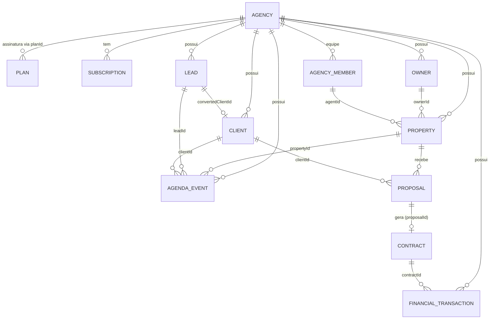

# Modelagem de Dados — Imobilypro

Etapa 03 do roadmap. Define as entidades do domínio, seus relacionamentos e o mapeamento futuro para tabelas no Supabase (etapa 12).

Todos os tipos vivem em `src/types/` e podem ser importados pelo barrel:

```ts
import type { Property, Lead, Contract } from '../types';
import { PROPERTY_STATUS } from '../types';
```

## Princípios

- **Multi-tenant**: toda entidade operacional possui `agencyId`. O Super Admin enxerga todas as agências; o corretor apenas as da sua agência (base para RLS na etapa 14).
- **Constantes + union types**: status e enums seguem o padrão do projeto (`X as const` + `keyof typeof`), sem `enum` (compatível com `erasableSyntaxOnly`).
- **Datas em ISO 8601 string**, valores em `number` (BRL).
- **IDs como `string`** (UUIDs no Supabase).

## Entidades

| Arquivo | Entidades |
|---|---|
| `src/types/common.ts` | `ID`, `Timestamps`, `Address`, `Paginated`, `DateRange`, `SortOption` |
| `src/types/auth.ts` | `User`, `AuthSession` (já existente) |
| `src/types/agency.ts` | `Agency`, `Plan`, `Subscription` |
| `src/types/property.ts` | `Property`, `PropertyPhoto`, `PropertyFilter` |
| `src/types/owner.ts` | `Owner` (proprietário) |
| `src/types/lead.ts` | `Lead`, `LeadInterest` |
| `src/types/client.ts` | `Client` |
| `src/types/team.ts` | `AgencyMember` (corretor/equipe) |
| `src/types/contract.ts` | `Proposal`, `Contract` |
| `src/types/agenda.ts` | `AgendaEvent` |
| `src/types/financial.ts` | `FinancialTransaction` |

## Relacionamentos



## Status principais

- `AgencyStatus`: `ACTIVE | TRIAL | SUSPENDED | BLOCKED`
- `SubscriptionStatus`: `trial | active | past_due | canceled`
- `PropertyStatus`: `available | reserved | sold | rented | inactive`
- `PropertyTransaction`: `sale | rent | sale_and_rent | seasonal`
- `LeadStatus`: `new | contacted | qualified | visit | proposal | won | lost`
- `ProposalStatus`: `draft | sent | analyzing | approved | rejected | expired`
- `ContractStatus`: `draft | active | finished | canceled | breached`
- `AgendaEventStatus`: `scheduled | done | canceled`
- `FinancialStatus`: `pending | paid | overdue | canceled`

## Mapeamento futuro (Supabase / etapa 12)

Cada entidade vira uma tabela. Regras de conversão:

| Tipo no código | Coluna Postgres |
|---|---|
| `ID` | `uuid primary key default gen_random_uuid()` |
| `string` (datas) | `timestamptz` |
| `Address` (objeto) | colunas achatadas ou tabela `addresses` |
| union types | `text check (col in (...))` |
| `PropertyPhoto[]` | tabela `property_photos` (FK `property_id`) |
| `features: string[]` | `text[]` |
| `agencyId` | `uuid not null references agencies(id)` + `RLS` |

Índices sugeridos: `properties(agency_id, status)`, `leads(agency_id, status)`, `agenda_events(agent_id, start_at)`, `financial_transactions(agency_id, due_at)`.
